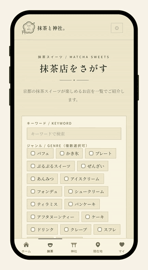
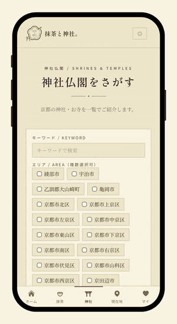
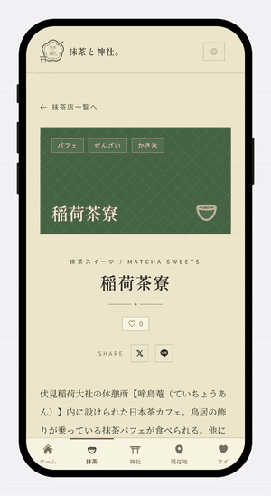
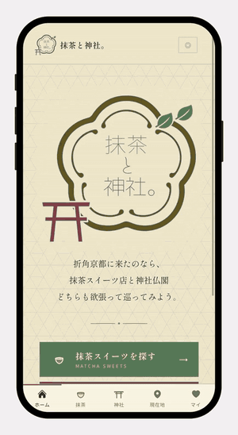
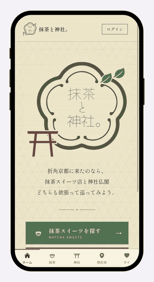
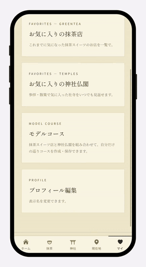
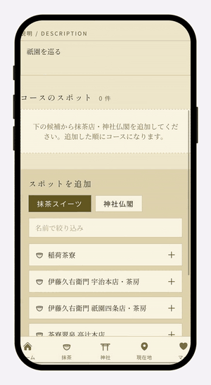
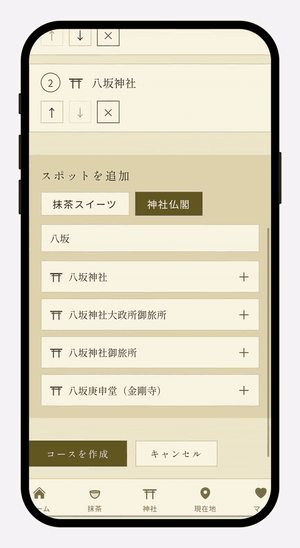
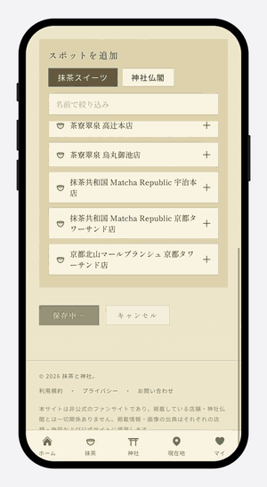

# 抹茶と神社。(matcha-to-jinja)

京都の抹茶スイーツ店と神社仏閣を組み合わせて紹介する Web アプリの **Next.js フロントエンド**。

既存の Rails アプリ [greentea_temple](https://github.com/hiiragi17/greentea_temple) を
「Rails API（バックエンド）+ Next.js（フロントエンド）」構成へ移行するプロジェクトの、フロント側リポジトリです。

## アーキテクチャ（2 リポジトリ構成）

| 役割 | リポジトリ | 内容 | デプロイ先 |
|------|-----------|------|-----------|
| フロントエンド | **matcha-to-jinja**（このリポジトリ） | Next.js | Vercel |
| バックエンド API | [greentea_temple](https://github.com/hiiragi17/greentea_temple) | Rails API（`api/v1` 名前空間） | GCP Cloud Run |

- フロントは Rails API の `GET/POST /api/v1/*` を叩いてデータを取得・更新します。
- 認証は Rails が JWT を発行し、フロントは NextAuth.js（Auth.js v5）経由で OAuth（Google / LINE）フローを管理します。
- **このリポジトリに Rails コードは含まれません。** バックエンドの変更は greentea_temple 側で行います。

## 主な機能

本番: https://matcha-to-jinja.vercel.app/

| 抹茶スイーツをさがす | 神社仏閣をさがす | 詳細ページ（地図・近くのスポット） |
|:---:|:---:|:---:|
|  |  |  |
| キーワードとジャンルで検索 | キーワードとエリアで検索 | 半径1.5km以内のスポットを地図と一覧で表示。X / LINE で共有 |

| 現在地から探す | ログイン・お気に入り・口コミ |
|:---:|:---:|
|  |  |
| 半径を選んで、近くの抹茶店（茶碗）と神社仏閣（鳥居）を地図と一覧で表示 | Google / LINE でログインすると、お気に入り登録と口コミの投稿・削除ができる |

**モデルコース**（ログインユーザー）: 行きたい抹茶スイーツ店・神社仏閣を選んで並べるだけで、自分だけの巡り方を作れます。コース詳細では、区間ごとの行き方を Google マップで確認できます。

| マイページ | 抹茶スイーツを追加 | 神社仏閣を追加 | 保存 |
|:---:|:---:|:---:|:---:|
|  |  |  |  |

## 技術スタック

- Next.js 16（App Router）+ React 19 + TypeScript 6
- Tailwind CSS v4 + daisyUI 5
- SWR（データフェッチ / キャッシュ）
- NextAuth.js（Auth.js v5、Google / LINE OAuth）
- react-icons / `@vis.gl/react-google-maps`
- react-hook-form + zod（フォームバリデーション）
- Vercel Analytics（アクセス解析）
- Vitest + React Testing Library + MSW（ユニット / 統合テスト）
- Playwright（E2E ゴールデンパス）
